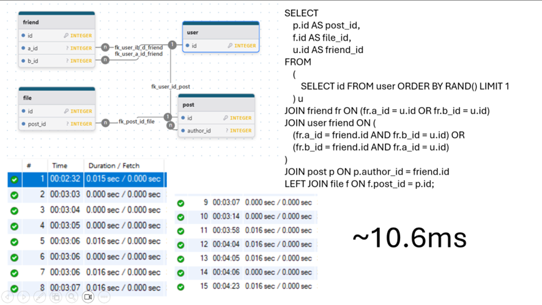
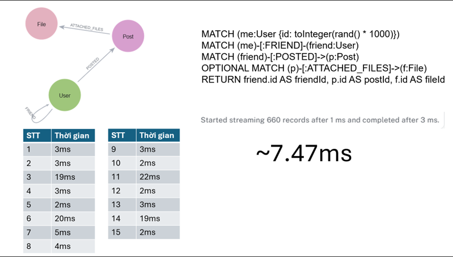
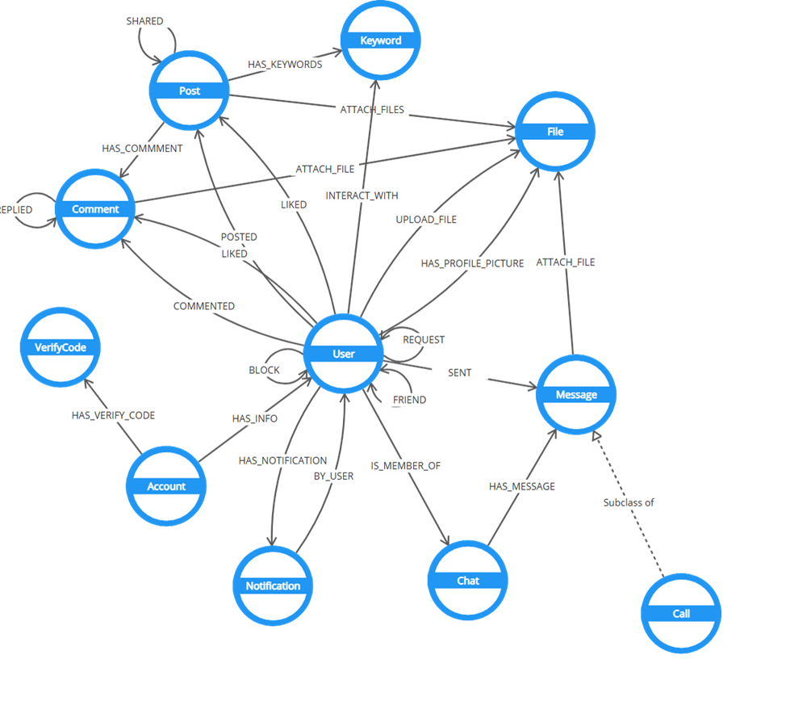

# APPLYING GRAPH DATABASE MODELING IN BUILDING A SOCIAL NETWORK WEBSITE


## Introduction

This is a web-based social network application designed to provide an online space where users can easily connect, share, and interact with one another. The system supports core features such as posting, commenting, friending, real-time messaging, and real-time notifications. The goal is to build a user-friendly, secure, and scalable platform for community connection, particularly tailored for Vietnamese users.

## Tech Stack

### Backend
- **Spring Boot**: Java framework for building web applications quickly with straightforward configuration and deployment
- **Neo4j**: Graph database ideal for storing and querying interconnected data based on relationships between entities
- **Redis**: In-memory data store used for caching, refresh tokens, rate limiting, and real-time presence/call states
- **SQLite**: Lightweight embedded database for logging online user statistics
- **WebSocket**: Full-duplex communication protocol between client and server for real-time messaging, typing indicators, and notifications

### Development Tools
- **IntelliJ IDEA**: Powerful IDE for Java and Spring Boot development
- **Docker**: Containerization platform for packaging and deploying the application and its dependencies
- **Git**: Distributed version control system

## Why Neo4j Instead of MySQL (RDBMS)?

In a social network, data is naturally modeled as a graph—such as `(User)-[:FRIEND]-(User)`, `(User)-[:LIKED]->(Post)`, etc. While this can be represented in an RDBMS using multiple join tables, that approach significantly increases schema and query complexity.

- **Higher query performance when traversing multiple relationships:**
  - In an RDBMS, complex relational queries require multiple `JOIN` operations. As tables and row counts grow, performance degrades due to table scans and join overhead.
  - With Neo4j, relationships (graph edges) between entities are stored directly. Queries traverse edges to retrieve related entities without `JOIN`s, delivering noticeably better performance for highly connected social data.

_Benchmarks show that Neo4j performs 3-hop relationship queries significantly faster than MySQL._




## Database Schema



## Key Features

- **Authentication**: Registration, email verification, login, password reset, and account management
- **Post Management**: Create, edit, share, like, and delete posts with privacy controls
- **Comments**: Comment and reply on posts
- **User Profile**: View and manage personal profile information
- **Real-Time Messaging & Calls**: Direct real-time chat (text, attachments, GIFs, voice) and audio/video calling via Stringee
- **Real-Time Notifications**: Live notification delivery
- **Search**: Search users, posts, and content
- **Relationship Management**: Send/accept friend requests, unfriend, and block users
- **Statistics**: Admin analytics for user activity, online users, and posts

## Project Challenges

- **Performance & Scalability**: Ensuring the system can serve a large number of concurrent users
- **Security & Privacy**: Protecting user data and defending against common vulnerabilities
- **Real-Time Capabilities**: Delivering low-latency messaging and notifications
- **User Experience**: Intuitive, responsive interface across devices
- **Relationship Management**: Supporting complex social graph relationships
- **Administration & Authorization**: Clear separation of roles and permissions for administrators
- **Caching & Pagination**: Efficiently handling large datasets

## Expected Outcomes

- A stable, full-featured social network backend
- Responsive and user-friendly client experience
- Smooth real-time features
- Comprehensive and flexible administration
- Strong security and privacy guarantees
- High maintainability and scalability

## Setup and Running the Project

### Prerequisites
- Java 17+
- Maven
- Docker and Docker Compose (optional if running Neo4j and Redis locally)
- Neo4j (can be run via Docker container)
- Redis (can be run via Docker container)

### Installation

1. Clone the repository:
```bash
git clone https://github.com/thangtranitwork/social-network.git
cd social-network
```

2. Configure environment variables in a `.env` file:
- `NEO4J_USER` = Neo4j username
- `NEO4J_PASS` = Neo4j password
- `NEO4J_URI` = Neo4j connection URI
- `JWT_ACCESS_TOKEN_KEY` = JWT signing secret key
- `JWT_ACCESS_TOKEN_DURATION` = Access token lifetime (in seconds)
- `JWT_REFRESH_TOKEN_DURATION` = Refresh token lifetime (in days)
- `VERIFY_EMAIL_DURATION` = Verification email lifetime
- `MAIL` = Gmail address
- `MAIL_PASSWORD` = Gmail app password
- `FRONTEND_ORIGIN` = Frontend URL
- `SELF_ORIGIN` = Backend URL
- `REDIS_HOST` = Redis host
- `REDIS_USERNAME` = Redis username
- `REDIS_PASSWORD` = Redis password
- `REDIS_PORT` = Redis port
- `STRINGEE_API_SID` = Stringee API SID
- `STRINGEE_API_SECRET_KEY` = Stringee API secret key
- `GEMINI_KEY` = Gemini API key from Google AI Studio

### Running with Docker Compose

Uncomment the `api` service in `docker-compose.yml`, then run:
```bash
docker compose --env-file .env up
```
or
```bash
docker-compose --env-file .env up
```

### Running with Java and Maven

If you run Neo4j and Redis via Docker:
```bash
docker compose --env-file .env up
```
Then run `.run-env.cmd`:
```bash
.run-env.cmd
```
**_[Server runs on port 2003](http://localhost:2003)_**

## Project Structure

```
social-network-api/
├── src/
│   └── main/
│       ├── java/            # Java source code
│       └── resources/       # Configuration and static/template resources
├── pom.xml                  # Maven configuration
├── docker-compose.yml       # Docker Compose configuration
├── Dockerfile               # Dockerfile configuration
├── .env                     # Environment variables
├── init-neo4j.sh            # Script to load initial data into Neo4j container
├── neo4j.dump               # Sample Neo4j database dump
└── README.md                # Project documentation
```

## Frontend
[Social Media App](https://github.com/Hoang18769/social-media-app)

## References
1. [Neo4j Documentation – Neo4j, Inc.](https://neo4j.com/docs/)
2. [Spring Framework Documentation – Spring Team](https://docs.spring.io/spring-framework/docs/current/reference/html/)
3. [React Documentation – Meta](https://react.dev/)
4. [Tailwind CSS Documentation – Tailwind Labs](https://tailwindcss.com/docs)
5. [Next.js Documentation – Vercel](https://nextjs.org/docs)
6. Christensen, J. (2025, March 13). [*Graph database vs. relational database: What’s the difference?*](https://neo4j.com/blog/graph-database/graph-database-vs-relational-database/)
7. Z. Zhang, Y. Liu, W. Ding, and W. W. Huang. *[A Friend Recommendation System Using Users’ Information of Total Attributes](https://www.cs.umb.edu/~ding/papers/ICDS2015.pdf)*, Dept. of Management, Xi’an Jiaotong University, and Dept. of Computer Science, Univ. of Massachusetts Boston.

## Contact
- Email: [thangtran.it.work@gmail.com](mailto:thangtran.it.work@gmail.com)
